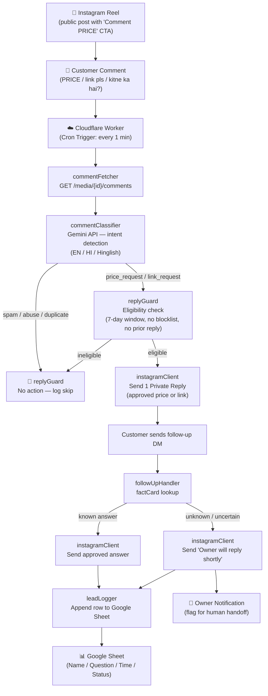
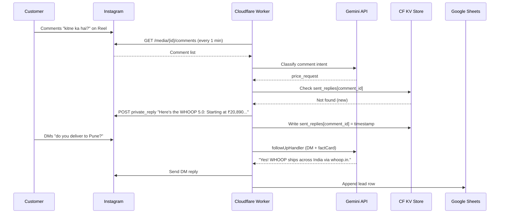
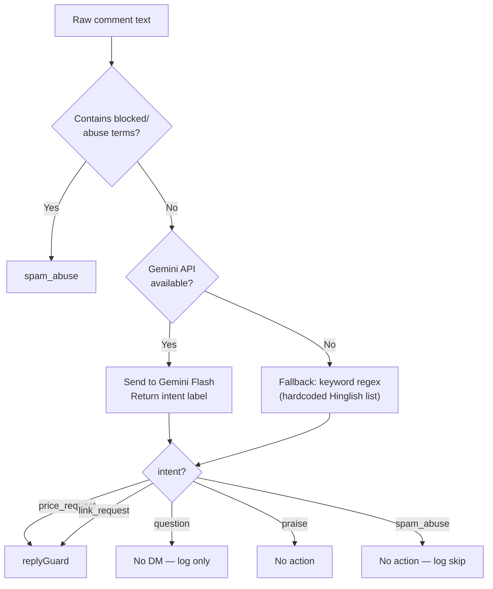

# Insta Growth Kit — Architecture

> End-to-end architecture for a small-business Instagram comment-to-lead automation system.

---

## Table of Contents

1. [System Overview](#1-system-overview)
2. [High-Level Architecture Diagram](#2-high-level-architecture-diagram)
3. [Module Breakdown](#3-module-breakdown)
4. [Data Flow — Full Journey](#4-data-flow--full-journey)
5. [Directory Structure](#5-directory-structure)
6. [Technology Stack](#6-technology-stack)
7. [External APIs & Integrations](#7-external-apis--integrations)
8. [Cloudflare Worker — Runtime Detail](#8-cloudflare-worker--runtime-detail)
9. [Comment Classification Logic](#9-comment-classification-logic)
10. [Fact Card & Follow-Up Handler](#10-fact-card--follow-up-handler)
11. [Lead Logger — Google Sheets](#11-lead-logger--google-sheets)
12. [Security & Credential Management](#12-security--credential-management)
13. [Testing Strategy](#13-testing-strategy)
14. [Milestone → Code Mapping](#14-milestone--code-mapping)
15. [Deployment Checklist](#15-deployment-checklist)
16. [Handover & Maintenance Guide](#16-handover--maintenance-guide)

---

## 1. System Overview

Insta Growth Kit is a **lean, single-product Instagram growth automation** built for a local shop owner. It has two logical halves:

| Half | What it does |
|---|---|
| **Creative** | Turns phone photos into polished ad images, a voiceover, and a 15-second Reel with a "Comment PRICE" CTA. |
| **Automation** | A deployed Cloudflare Worker polls Reel comments every minute, classifies intent (English / Hindi / Hinglish), sends one approved private reply per eligible commenter, handles follow-ups with shop-approved facts, and logs every lead to Google Sheets. |

The automation half is the **primary software artefact** that this architecture document covers.

> [!IMPORTANT]
> All live API calls must be verified against current Meta developer documentation before deployment. Permissions, messaging windows, and endpoint availability change. The architecture below documents the *intended* flow; always reconcile with live Meta policy.

---

## 2. High-Level Architecture Diagram



---

## 3. Module Breakdown

### 3.1 `commentFetcher`

**Responsibility:** Fetch new comments on the target Reel that have not yet been processed.

**Key logic:**
- Calls `GET /{media-id}/comments` via the Instagram Graph API.
- Uses a **cursor / timestamp watermark** stored in Cloudflare KV to avoid re-processing old comments.
- Returns a list of `{comment_id, from_id, from_username, text, timestamp}` objects.

**Inputs:** `MEDIA_ID` (env var), `INSTAGRAM_ACCESS_TOKEN` (env var), last-processed cursor (KV store).  
**Outputs:** Array of raw comment objects.

---

### 3.2 `commentClassifier`

**Responsibility:** Classify each comment into one of five intents.

| Intent label | Example triggers |
|---|---|
| `price_request` | "PRICE", "rate?", "kitne ka hai?", "cost?", "how much?" |
| `link_request` | "LINK", "link pls", "where to buy?", "website?" |
| `question` | "do you deliver?", "COD available?", "size?" |
| `praise` | "so good 🔥", "love this!" |
| `spam_abuse` | offensive language, repetitive bot-like text |

**Implementation — Gemini API call:**
```
System prompt: You are a comment classifier for a WHOOP fitness tracker Instagram account in India.
Classify the following comment into exactly one of:
price_request | link_request | question | praise | spam_abuse.
Reply with ONLY the label. Comment: "{comment_text}"
```

- Uses **Gemini Flash** (low-cost, fast) for classification.
- Falls back to a local **keyword regex list** (Hinglish keywords hardcoded) if the API call fails, ensuring the system degrades gracefully.
- Returns `{comment_id, intent, confidence}`.

---

### 3.3 `replyGuard`

**Responsibility:** Final gate before any private message is sent.

Checks (in order):
1. **Intent eligibility** — only `price_request` and `link_request` trigger a DM.
2. **7-day eligibility window** — comment timestamp must be within 7 days.
3. **Blocklist** — `from_id` or `from_username` not in blocked-users KV list.
4. **Duplicate guard** — `comment_id` not already in `sent_replies` KV store.
5. **Blocked terms** — comment text does not contain any term from the abuse blocklist.

Writes `comment_id → timestamp` to `sent_replies` KV store after allowing a reply.

**Outputs:** `{allowed: boolean, reason: string}`.

---

### 3.4 `instagramClient`

**Responsibility:** Thin wrapper around all outgoing Meta API calls.

Exposes:

| Function | Meta API endpoint |
|---|---|
| `getComments(mediaId)` | `GET /{media-id}/comments` |
| `sendPrivateReply(commentId, message)` | `POST /{comment-id}/private_replies` |
| `sendDM(userId, message)` | `POST /me/messages` (Messenger API) |
| `getConversations(userId)` | `GET /me/conversations` |

> [!WARNING]
> `private_replies` is only available within a **24-hour window** from the comment, and may require specific permissions (`instagram_manage_messages`). Verify current Meta policy before going live.

All calls include the `access_token` and handle rate-limit errors (HTTP 429) with an exponential backoff retry (max 3 retries).

---

### 3.5 `factCard` / `followUpHandler`

**Responsibility:** Answer permitted follow-up DMs using **only** owner-approved facts.

`factCard` is a plain JSON file (edited by the owner):
```json
{
  "product_name": "WHOOP 5.0",
  "brand": "WHOOP",
  "price": "Starting at ₹20,890 (WHOOP One) / ₹27,539 (WHOOP Peak)",
  "offer": "Up to 6 months No-Cost EMI available — MRP savings up to ₹1,451!",
  "key_benefits": ["Screen-free 24/7 wearable", "14+ days battery life", "Core Four: Strain, Recovery, Sleep, Stress"],
  "delivery": "Ships across India via whoop.in",
  "cod_available": false,
  "location": "Available online at whoop.in and select retail partners across India",
  "contact": "DM us or visit https://www.whoop.in/",
  "timings": "Online store — available 24/7",
  "website": "https://www.whoop.in/"
}
```

`followUpHandler` logic:
1. Receives incoming DM text.
2. Sends DM + factCard to Gemini with strict instructions:
   - Answer *only* from factCard fields.
   - If information is not in the factCard, reply: `"Great question! The owner will get back to you shortly. 🙏"` and set `needs_handoff: true`.
3. Returns `{reply_text, needs_handoff}`.

> [!CAUTION]
> The AI must never invent prices, discounts, or availability. The system prompt must explicitly prohibit hallucination of shop facts.

---

### 3.6 `leadLogger`

**Responsibility:** Append one row to Google Sheets for every handled interaction.

**Row schema:**

| Column | Value |
|---|---|
| `Timestamp` | ISO 8601 (IST) |
| `Username` | Instagram handle |
| `User ID` | Instagram `from_id` |
| `Comment Text` | Raw comment |
| `Intent` | Classifier label |
| `Reply Sent` | Yes / No |
| `Follow-up Question` | DM text if any |
| `Needs Owner` | TRUE / FALSE |
| `Status` | `open` / `closed` |

**Implementation:** Google Sheets REST API (OAuth2 service account) using `spreadsheets.values.append`.

---

### 3.7 `tests`

A standalone test suite (Node.js / Vitest) that runs **entirely with mock data** — no live API calls required.

| Test file | Covers |
|---|---|
| `classifier.test.ts` | 30 sample comments → correct intent (target: ≥ 25/30) |
| `replyGuard.test.ts` | Duplicates, blocklist, 7-day window edge cases |
| `factCard.test.ts` | Known answer, unknown answer → handoff flag |
| `leadLogger.test.ts` | Row schema correctness, deduplication |
| `instagramClient.test.ts` | Mock API responses, rate-limit retry logic |

---

## 4. Data Flow — Full Journey



---

## 5. Directory Structure

```
insta-growth-kit/
│
├── worker/                          # Cloudflare Worker source
│   ├── src/
│   │   ├── index.ts                 # Entry point — cron handler
│   │   ├── commentFetcher.ts
│   │   ├── commentClassifier.ts
│   │   ├── replyGuard.ts
│   │   ├── instagramClient.ts
│   │   ├── followUpHandler.ts
│   │   ├── leadLogger.ts
│   │   └── types.ts                 # Shared TypeScript interfaces
│   │
│   ├── data/
│   │   └── factCard.json            # Owner-editable product facts
│   │
│   ├── tests/
│   │   ├── classifier.test.ts
│   │   ├── replyGuard.test.ts
│   │   ├── factCard.test.ts
│   │   ├── leadLogger.test.ts
│   │   └── instagramClient.test.ts
│   │
│   ├── wrangler.toml                # Cloudflare Worker config
│   ├── package.json
│   └── tsconfig.json
│
├── creative/                        # Non-code assets (manual workflow)
│   ├── product-photos/              # Original phone photos (3–5)
│   ├── ad-images/                   # Three finished ad images (9:16 & 1:1)
│   ├── voiceover.mp3                # AI-generated voiceover
│   └── reel-link.txt                # Published Reel URL
│
├── docs/
│   ├── owner-handover.md            # One-page shop owner guide
│   ├── reel-insights.md             # 48-hour insights + 3 improvement ideas
│   └── architecture.md             # This file
│
├── ProblemStatement.md
└── .env.example                     # Template for environment variables
```

---

## 6. Technology Stack

| Layer | Technology | Why |
|---|---|---|
| Runtime / hosting | **Cloudflare Workers** | Zero-cold-start, free cron triggers, global edge, cheap |
| Language | **TypeScript** | Type safety, good DX, works natively on CF Workers |
| AI Classification | **Gemini Flash API** | Multilingual (EN/HI/Hinglish), fast, low cost |
| AI Follow-up | **Gemini Flash API** | Constrained to factCard; same API key |
| State / dedup store | **Cloudflare KV** | Key-value store for sent replies and watermarks |
| Instagram API | **Meta Graph API v18+** | Official, compliant comment + private-reply endpoints |
| Lead capture | **Google Sheets API v4** | Familiar to shop owners, zero infra, shareable |
| Testing | **Vitest** | Fast, works with TypeScript, no extra config |
| Creative tools | Gemini App, Canva, Google AI Studio, Instagram Edits | Phone-first, no code needed |

---

## 7. External APIs & Integrations

### 7.1 Meta / Instagram Graph API

| Item | Detail |
|---|---|
| App type | Meta developer app (Business type) |
| Required permissions | `instagram_basic`, `instagram_manage_comments`, `instagram_manage_messages`, `pages_read_engagement` |
| Token type | Long-lived Page Access Token (60-day expiry) or System User token |
| Base URL | `https://graph.facebook.com/v18.0` |
| Rate limits | ~200 calls/hour per token (verify in Meta docs) |
| Auth refresh | Must be refreshed before expiry; documented in handover guide |

### 7.2 Gemini API

| Item | Detail |
|---|---|
| Model | `gemini-1.5-flash-latest` (or latest available Flash model) |
| Auth | API key stored in CF Worker secret |
| Classification prompt | Single-shot, returns one label only |
| Follow-up prompt | Grounded to factCard; hallucination prohibited via system prompt |

### 7.3 Google Sheets API

| Item | Detail |
|---|---|
| Auth | OAuth2 service account JSON key (stored as CF secret) |
| Sheet ID | Stored as env var `LEAD_SHEET_ID` |
| Method | `spreadsheets.values.append` with `valueInputOption=USER_ENTERED` |
| Sheet name | `Leads` tab |

---

## 8. Cloudflare Worker — Runtime Detail

### `wrangler.toml` skeleton

```toml
name = "insta-growth-kit"
main = "src/index.ts"
compatibility_date = "2024-01-01"

[triggers]
crons = ["* * * * *"]   # Every 1 minute

[[kv_namespaces]]
binding = "REPLY_STORE"
id = "<your-kv-namespace-id>"

[vars]
MEDIA_ID = "<reel-media-id>"
LEAD_SHEET_ID = "<google-sheet-id>"
```

### Secrets (set via `wrangler secret put`)

```
INSTAGRAM_ACCESS_TOKEN
GEMINI_API_KEY
GOOGLE_SERVICE_ACCOUNT_JSON
```

### Worker Entry Point (`index.ts`) — pseudocode

```typescript
export default {
  async scheduled(event, env, ctx) {
    const comments = await commentFetcher(env);
    for (const comment of comments) {
      const { intent } = await commentClassifier(comment.text, env);
      const { allowed } = await replyGuard(comment, intent, env);
      if (allowed) {
        await instagramClient.sendPrivateReply(comment.id, buildReply(intent, env), env);
        await leadLogger.append(comment, intent, env);
      }
    }
  },
  async fetch(request, env) {
    // Optional: webhook endpoint for incoming DMs
    return handleIncomingDM(request, env);
  }
};
```

---

## 9. Comment Classification Logic

### Intent Decision Tree



### Hinglish Keyword Fallback List (starter)

```typescript
const PRICE_KEYWORDS = [
  /\bprice\b/i, /\brate\b/i, /\bcost\b/i, /\bhow much\b/i,
  /kitne ka/i, /kitna hai/i, /kya rate/i, /\bdaam\b/i,
  /\bMRP\b/i, /\bpricelist\b/i
];

const LINK_KEYWORDS = [
  /\blink\b/i, /\bwebsite\b/i, /\bwhere to buy\b/i,
  /\border\b/i, /\bshop\b/i, /kahan milega/i
];
```

---

## 10. Fact Card & Follow-Up Handler

### Gemini System Prompt for Follow-Ups

```
You are a helpful assistant for WHOOP India's Instagram account.
Answer the customer's question using ONLY the information in the fact card below.
If the answer is not in the fact card, reply EXACTLY:
"Great question! The owner will get back to you shortly. 🙏"
and set needs_handoff to true.
Never invent prices, discounts, delivery times, or availability.
Reply in the same language the customer used (English, Hindi, or Hinglish).

FACT CARD:
{factCardJSON}

CUSTOMER MESSAGE:
{customerMessage}

Respond in JSON: { "reply": "...", "needs_handoff": false }
```

---

## 11. Lead Logger — Google Sheets

### Setup Steps

1. Create a Google Sheet named **"Insta Growth Kit Leads"** with a tab named `Leads`.
2. Add header row: `Timestamp | Username | User ID | Comment | Intent | Reply Sent | Follow-up | Needs Owner | Status`
3. Create a GCP service account → download JSON key → share the Sheet with the service account email.
4. Store the JSON key as `GOOGLE_SERVICE_ACCOUNT_JSON` CF secret.

### Append Logic

```typescript
async function appendLead(row: LeadRow, env: Env) {
  const auth = new GoogleAuth(env.GOOGLE_SERVICE_ACCOUNT_JSON);
  await fetch(
    `https://sheets.googleapis.com/v4/spreadsheets/${env.LEAD_SHEET_ID}/values/Leads!A1:I1:append?valueInputOption=USER_ENTERED`,
    {
      method: "POST",
      headers: { Authorization: `Bearer ${await auth.getToken()}` },
      body: JSON.stringify({ values: [row.toArray()] }),
    }
  );
}
```

---

## 12. Security & Credential Management

| Credential | Storage | Rotation |
|---|---|---|
| `INSTAGRAM_ACCESS_TOKEN` | CF Worker secret | Refresh before 60-day expiry |
| `GEMINI_API_KEY` | CF Worker secret | Rotate if leaked |
| `GOOGLE_SERVICE_ACCOUNT_JSON` | CF Worker secret | Annual key rotation |
| `LEAD_SHEET_ID` | `wrangler.toml` env var | Static |
| `MEDIA_ID` | `wrangler.toml` env var | Update per Reel |

> [!CAUTION]
> Never commit secrets to Git. Use `.env.example` with placeholder values only. Add `.env` and any files containing real secrets to `.gitignore`.

**Additional safeguards:**
- Collect only minimum required data (username, question, timestamp). Do not store DM thread history beyond the current session.
- Apply a **blocklist** (KV store) for abusive users to prevent repeated classification.
- Log skipped comments (spam/ineligible) for the owner to audit but do not expose personal data.

---

## 13. Testing Strategy

### Philosophy

> Build with mocks first → validate logic → switch to live API for required proof.

### Test Coverage Targets

| Area | Target | Method |
|---|---|---|
| Comment classifier | ≥ 25 / 30 correct | 30 labeled test comments in `classifier.test.ts` |
| Duplicate guard | 100% | Unit test: same comment_id sent twice |
| 7-day window | 100% | Unit test: comment at day 0, day 6, day 8 |
| factCard answers | Known + unknown | Mocked Gemini response |
| Lead row schema | 100% | Assert all 9 columns present |
| API retry logic | 100% | Mock 429 → retry → success |

### Running Tests

```bash
cd worker
npm install
npm test            # Vitest runs all *.test.ts files
npm run test:watch  # Watch mode during development
```

---

## 14. Milestone → Code Mapping

| Milestone | Key files | Done when… |
|---|---|---|
| **M1 — Ad Image** | `creative/` folder | 3 ad images + voiceover.mp3 exist |
| **M2 — Reel** | `creative/reel-link.txt`, `docs/reel-insights.md` | Public Reel live; 48h insights written |
| **M3 — DM Bot** | `commentFetcher`, `commentClassifier`, `replyGuard`, `instagramClient`, `tests/` | ≥ 25/30 test comments correct; screen recording of real DM |
| **M4 — Complete Kit** | `followUpHandler`, `leadLogger`, `data/factCard.json`, `docs/owner-handover.md` | 10+ lead rows in sheet; 60–90s demo recorded |

---

## 15. Deployment Checklist

```
□ Meta developer app created and approved for required permissions
□ Instagram professional account linked to Meta app
□ Long-lived access token generated and stored as CF secret
□ Reel published; MEDIA_ID captured and set in wrangler.toml
□ Cloudflare account created; wrangler CLI authenticated
□ KV namespace created; binding added to wrangler.toml
□ Google Sheet created; service account added with Editor permission
□ All secrets set via `wrangler secret put`
□ All 5 test suites passing locally
□ `wrangler deploy` executed successfully
□ Cron trigger verified in Cloudflare dashboard
□ One live test comment posted → DM received → lead row appears in sheet
□ factCard.json reviewed and approved by shop owner
□ Owner handover document completed and shared
```

---

## 16. Handover & Maintenance Guide

> This section is extracted into `docs/owner-handover.md` for the shop owner.

### What the kit does (in plain English)

Every minute, the bot checks for new comments on your Instagram Reel. If someone asks for a price or link, it automatically sends them a private message with your approved price/offer. If they reply with a question, it answers from your fact card. Every person who shows interest is saved to your Google Sheet.

### How to change the price or offer

1. Open `worker/data/factCard.json` in any text editor.
2. Update the `"price"` or `"offer"` field.
3. Run `wrangler deploy` from the `worker/` folder (or ask your developer).

### How to view leads

Open the **"Insta Growth Kit Leads"** Google Sheet. New rows appear automatically.

### Monthly maintenance

| Task | When | How |
|---|---|---|
| Refresh Instagram token | Before 60-day expiry | Follow Meta's token refresh guide; update CF secret |
| Check Worker error logs | Weekly | Cloudflare dashboard → Workers → Logs |
| Review blocked users list | Monthly | Edit `blocked_users` in CF KV |
| Update factCard | When prices change | Edit `factCard.json` → redeploy |

### What needs a developer

- Changing which Reel the bot monitors (`MEDIA_ID`).
- Adding new products (requires a new factCard and new Reel).
- If Meta changes API permissions or endpoints.

---

*Last updated: November 2026 · Built with Cloudflare Workers, Gemini API, Meta Graph API, Google Sheets.*

