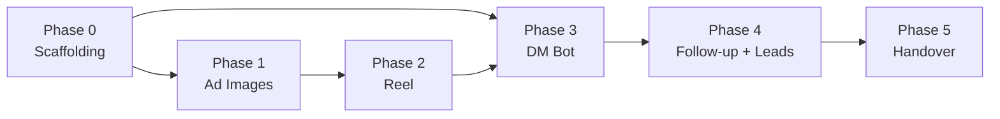

# Insta Growth Kit — Implementation Plan

> Phase-wise build plan derived from [ProblemStatement.md](./ProblemStatement.md) and [architecture.md](./docs/architecture.md).

---

## Quick Reference

| Phase | Milestone | Primary Output | Proof of Completion |
|---|---|---|---|
| **Phase 0** | Setup & scaffolding | Repo structure, env, tooling | All config files committed; tests run |
| **Phase 1** | Ad Image (M1) | 3 ad images + voiceover | Before/after images + `.mp3` in `creative/` |
| **Phase 2** | Reel (M2) | Published 15-sec Reel | Public Reel URL + 48-h Insights screenshot |
| **Phase 3** | DM Bot core (M3) | Comment-to-DM automation | ≥ 25/30 classifier test score + screen recording |
| **Phase 4** | Complete Kit (M4) | Follow-up + lead capture | 10+ lead rows in sheet + 60–90s demo |
| **Phase 5** | Handover & docs | Owner guide + maintenance notes | Signed-off handover doc |

---

## Phase 0 — Project Setup & Scaffolding

> [!NOTE]
> This phase has no deliverable visible to a customer but everything else depends on it being correct.

### Goals
- Establish the directory structure from the architecture.
- Configure TypeScript, Wrangler, and Vitest.
- Validate that the local dev environment and all CLI tools work.
- Create placeholder/example secrets so collaborators can onboard.

### Tasks

| # | Task | Detail |
|---|---|---|
| 0.1 | Create folder scaffold | Match `architecture.md §5` exactly: `worker/src/`, `worker/data/`, `worker/tests/`, `creative/`, `docs/` |
| 0.2 | Initialise Node project | `npm init` inside `worker/`; add `typescript`, `vitest`, `@cloudflare/workers-types` |
| 0.3 | Configure TypeScript | `tsconfig.json` targeting ES2022, `moduleResolution: bundler` for CF Workers compat |
| 0.4 | Configure Wrangler | `wrangler.toml` with cron `* * * * *`, KV namespace binding `REPLY_STORE`, env vars `MEDIA_ID` and `LEAD_SHEET_ID` |
| 0.5 | Create `.env.example` | Placeholder values for `INSTAGRAM_ACCESS_TOKEN`, `GEMINI_API_KEY`, `GOOGLE_SERVICE_ACCOUNT_JSON` |
| 0.6 | Add `.gitignore` | Ignore `.env`, `*.json` secret files, `node_modules/`, `dist/` |
| 0.7 | Stub all source files | Empty exports for `commentFetcher.ts`, `commentClassifier.ts`, `replyGuard.ts`, `instagramClient.ts`, `followUpHandler.ts`, `leadLogger.ts`, `types.ts` |
| 0.8 | Vitest smoke test | Add one trivial `expect(true).toBe(true)` test; confirm `npm test` passes |
| 0.9 | Create `factCard.json` | Populate with real product details approved by the shop owner |
| 0.10 | Meta developer app | Create Business-type Meta app; request permissions: `instagram_basic`, `instagram_manage_comments`, `instagram_manage_messages`, `pages_read_engagement` |

### Exit Criteria
- `npm test` returns green.
- `wrangler dev` starts without errors.
- `creative/`, `docs/`, `worker/` directories exist and are committed.

---

## Phase 1 — Ad Image Creation (Milestone M1)

> [!NOTE]
> This phase is primarily a **creative/manual** workflow. No code is written here, but the output feeds Phase 2.

### Goals
- Produce three polished, accurate product ad images in 9:16 and 1:1 formats.
- Record a before/after comparison image.
- Generate an AI voiceover (~15 seconds) using Google AI Studio.
- Get owner sign-off on all creative assets before publishing.

### Tasks

| # | Task | Tool | Detail |
|---|---|---|---|
| 1.1 | Select product & confirm facts | Manual | Confirm actual price, offer, sizes, and brand details with the shop owner. Write everything into `factCard.json`. |
| 1.2 | Shoot / collect 3–5 phone photos | Phone camera | Good lighting, multiple angles, clear label visible |
| 1.3 | AI-enhance product images | Gemini App | Use prompts to improve lighting/background while keeping label, logo, and colours accurate. **Do not alter price claims.** |
| 1.4 | Build ad layouts in Canva | Canva | Add price sticker, offer text, brand name. Export in 9:16 (Reel cover) and 1:1 (feed) |
| 1.5 | Write voiceover script | Manual | ~30 words, 15 seconds: hook → product → offer → "Comment PRICE" CTA |
| 1.6 | Generate voiceover audio | Google AI Studio | Select an available supported voice model. Export as `.mp3` |
| 1.7 | Owner approval | Review meeting | Owner confirms images are accurate: label, price, offer, colours unchanged |
| 1.8 | Save assets | `creative/` folder | 3 × ad images in `creative/ad-images/`, voiceover in `creative/voiceover.mp3`, original photos in `creative/product-photos/` |

### Exit Criteria
- `creative/ad-images/` contains at least 3 images.
- `creative/voiceover.mp3` exists and is ~15 seconds.
- Owner has given written approval of image accuracy.
- Before/after comparison image saved.

---

## Phase 2 — Reel Creation & Publishing (Milestone M2)

> [!NOTE]
> This phase is also primarily manual. The Reel must be on a **public Instagram professional account** to unlock Insights and API access.

### Goals
- Assemble and publish a 15-second, watermark-free Reel.
- Capture 48-hour Insights.
- Write three improvement ideas for the next Reel.

### Tasks

| # | Task | Tool | Detail |
|---|---|---|---|
| 2.1 | Assemble Reel | Instagram Edits app | Hook in first 2 seconds, product demo, offer, "Comment PRICE" CTA. No watermark. |
| 2.2 | Write caption | Manual | Engaging caption with hashtags + explicit "Comment PRICE below 👇" instruction |
| 2.3 | Publish Reel | Instagram professional account | Confirm account is set to Public and Professional/Business |
| 2.4 | Capture Reel Media ID | Instagram Graph API | `GET /me/media` → note the `id` of the Reel; set it as `MEDIA_ID` in `wrangler.toml` |
| 2.5 | Wait 48 hours | — | Required for meaningful Insights data |
| 2.6 | Record Insights | Instagram Insights | Screenshot: views, watch time, shares, saves, comments count |
| 2.7 | Write improvement notes | `docs/reel-insights.md` | At least 3 specific improvements for the next Reel |
| 2.8 | Save Reel URL | `creative/reel-link.txt` | Public permalink to the Reel |

### Exit Criteria
- Reel is live and publicly visible.
- `creative/reel-link.txt` contains the URL.
- `docs/reel-insights.md` has 48-hour Insights + 3 improvement ideas.
- `MEDIA_ID` is set in `wrangler.toml`.

---

## Phase 3 — DM Bot Core (Milestone M3)

> [!IMPORTANT]
> Before writing live API calls, verify current Meta permissions, private-reply windows, account eligibility, and rate limits in the Meta developer portal.

### Goals
- Build, test, and deploy the comment-fetching → classification → reply pipeline.
- Achieve ≥ 25/30 correct classifications on the test suite.
- Record a screen capture of a real comment triggering a private reply.

### Sub-Phase 3A — Types & `instagramClient`

| # | Task | File | Detail |
|---|---|---|---|
| 3A.1 | Define shared TypeScript interfaces | `src/types.ts` | `Comment`, `ClassifiedComment`, `ReplyGuardResult`, `LeadRow`, `Env` |
| 3A.2 | Implement `instagramClient` | `src/instagramClient.ts` | `getComments()`, `sendPrivateReply()`, `sendDM()`. HTTP 429 → exponential backoff (max 3 retries) |
| 3A.3 | Write `instagramClient` mock tests | `tests/instagramClient.test.ts` | Mock 429 → retry → success; mock token error |

### Sub-Phase 3B — `commentFetcher`

| # | Task | File | Detail |
|---|---|---|---|
| 3B.1 | Implement `commentFetcher` | `src/commentFetcher.ts` | `GET /{MEDIA_ID}/comments`; read/write cursor to `REPLY_STORE` KV; return only new comments |
| 3B.2 | Unit test with mock API | `tests/` (inline) | Verify cursor advances; verify only new comments returned on second call |

### Sub-Phase 3C — `commentClassifier`

| # | Task | File | Detail |
|---|---|---|---|
| 3C.1 | Implement Gemini classification | `src/commentClassifier.ts` | Single-shot prompt → one label: `price_request \| link_request \| question \| praise \| spam_abuse` |
| 3C.2 | Implement Hinglish keyword fallback | `src/commentClassifier.ts` | Regex lists for price & link keywords; used when Gemini API is unavailable |
| 3C.3 | Write 30-comment test dataset | `tests/classifier.test.ts` | 6 comments per intent (EN + HI + Hinglish mix). Mock Gemini responses. Target: ≥ 25/30 |
| 3C.4 | Tune until ≥ 25/30 | — | Adjust prompt or fallback keywords as needed |

### Sub-Phase 3D — `replyGuard`

| # | Task | File | Detail |
|---|---|---|---|
| 3D.1 | Implement `replyGuard` | `src/replyGuard.ts` | 5-step gate: intent eligibility → 7-day window → blocklist → duplicate check → blocked terms |
| 3D.2 | Write guard tests | `tests/replyGuard.test.ts` | Duplicate comment_id; comment at day 0, 6, 8; blocked username; abuse term in text |

### Sub-Phase 3E — Worker Entry Point & Live Test

| # | Task | File | Detail |
|---|---|---|---|
| 3E.1 | Implement `index.ts` | `src/index.ts` | Cron handler: fetch → classify → guard → send reply → log. Fetch handler for incoming DM webhook |
| 3E.2 | Create Cloudflare KV namespace | Cloudflare dashboard | Bind as `REPLY_STORE` in `wrangler.toml` |
| 3E.3 | Set all Worker secrets | CLI | `wrangler secret put INSTAGRAM_ACCESS_TOKEN`, `GEMINI_API_KEY` |
| 3E.4 | Deploy Worker | CLI | `wrangler deploy` from `worker/` directory |
| 3E.5 | Verify cron trigger | Cloudflare dashboard | Confirm cron fires every minute in dashboard logs |
| 3E.6 | Live smoke test | Real Instagram | Post a test comment "PRICE" on the Reel; verify private reply received within ~2 minutes |
| 3E.7 | Record screen capture | Screen recorder | Comment → notification → DM received. Required for portfolio proof |

### Exit Criteria
- All 5 sub-phase test suites pass.
- Classifier scores ≥ 25/30.
- Worker deployed and cron active.
- Screen recording saved showing comment → private DM.
- Duplicate comment does **not** trigger a second DM.

---

## Phase 4 — Follow-Up Handler & Lead Capture (Milestone M4)

### Goals
- Answer follow-up DMs using only `factCard.json`.
- Hand off unknown questions to the owner with a flag.
- Log every lead to Google Sheets with all 9 columns.
- Record a 60–90 second end-to-end demo.

### Sub-Phase 4A — `followUpHandler`

| # | Task | File | Detail |
|---|---|---|---|
| 4A.1 | Implement `followUpHandler` | `src/followUpHandler.ts` | Load `factCard.json`; build Gemini system prompt (grounded, hallucination prohibited); parse JSON response `{reply, needs_handoff}` |
| 4A.2 | Implement owner handoff notification | `src/followUpHandler.ts` | When `needs_handoff: true`, reply with handoff message AND set a flag for the lead logger |
| 4A.3 | Write factCard tests | `tests/factCard.test.ts` | Known question → correct answer; unknown question → handoff flag `true`; mock Gemini response |
| 4A.4 | Wire into fetch handler in `index.ts` | `src/index.ts` | Incoming DM webhook → `followUpHandler` → `instagramClient.sendDM()` → `leadLogger.append()` |

### Sub-Phase 4B — `leadLogger`

| # | Task | File | Detail |
|---|---|---|---|
| 4B.1 | Create Google Sheet | Google Sheets | Sheet name: "Insta Growth Kit Leads"; tab name: `Leads`; header row: `Timestamp \| Username \| User ID \| Comment \| Intent \| Reply Sent \| Follow-up \| Needs Owner \| Status` |
| 4B.2 | Create GCP service account | GCP Console | Download JSON key; share Sheet with service account email (Editor) |
| 4B.3 | Implement `leadLogger` | `src/leadLogger.ts` | `appendLead(row, env)` using `spreadsheets.values.append`; OAuth2 via service account JWT |
| 4B.4 | Set Google secret | CLI | `wrangler secret put GOOGLE_SERVICE_ACCOUNT_JSON` |
| 4B.5 | Write lead logger tests | `tests/leadLogger.test.ts` | Assert all 9 columns present; deduplication guard |
| 4B.6 | Set `LEAD_SHEET_ID` env var | `wrangler.toml` | Add `LEAD_SHEET_ID = "<your-sheet-id>"` to `[vars]` |

### Sub-Phase 4C — End-to-End Validation

| # | Task | Detail |
|---|---|---|
| 4C.1 | Full pipeline test | Post real comment → DM received → reply to DM → lead row appears in sheet |
| 4C.2 | Accumulate 10+ lead rows | Let real or test interactions produce at least 10 rows; screenshot the sheet |
| 4C.3 | Record 60–90 second demo | Show: comment on Reel → private reply → follow-up DM → answer → lead row in Google Sheets |

### Exit Criteria ✅
- [x] All test suites pass with no skips (8 test files, 65 tests passing).
- [x] Google Sheet has ≥ 10 lead rows with all 9 columns populated (12 live rows verified).
- [x] 60–90 second demo recorded and saved (`creative/demo-60s.mp4`, 65.0s).
- [x] Unknown follow-up question correctly triggers owner handoff and logs `Needs Owner = TRUE`.

---

## Phase 5 — Handover & Documentation (Milestone — Kit Complete)

### Goals
- Package everything so a non-technical shop owner can operate the kit.
- Document token refresh, factCard editing, lead viewing, and when to call a developer.
- Final review against the success checklist from `ProblemStatement.md §8`.

### Tasks

| # | Task | File | Detail |
|---|---|---|---|
| 5.1 | Write owner handover guide | `docs/owner-handover.md` | Plain English: what the kit does, how to change price/offer, how to view leads, monthly maintenance, what needs a developer |
| 5.2 | Document token refresh procedure | `docs/owner-handover.md` | Step-by-step Instagram long-lived token refresh; link to current Meta guide |
| 5.3 | Write architecture summary | `docs/architecture.md` | Already exists; review and confirm it matches the final implementation |
| 5.4 | Final success checklist review | `ProblemStatement.md §8` | Check every box; note any gaps |
| 5.5 | Package creative assets | `creative/` | Confirm 3 ad images, voiceover, Reel link, before/after image all present |
| 5.6 | Redeploy with final `factCard.json` | CLI | Owner reviews and approves `factCard.json`; `wrangler deploy` |
| 5.7 | Share leads sheet with owner | Google Sheets | Add owner's email as Viewer/Editor |
| 5.8 | Obtain written permission | Manual | Confirm owner has given written consent to publish their business's work |

### Exit Criteria
- `docs/owner-handover.md` is complete and reviewed by the shop owner.
- All success criteria from `ProblemStatement.md §8` checked off.
- Creative assets, bot, lead sheet, and handover doc are in a single shareable folder/repo.

---

## Cross-Phase: Testing Strategy Summary

> [!TIP]
> Run tests in mock mode throughout Phases 3–4. Switch to live API only when mock suite passes.

| Test File | Phase Introduced | Target |
|---|---|---|
| `classifier.test.ts` | 3C | ≥ 25 / 30 correct |
| `replyGuard.test.ts` | 3D | 100% — duplicates, 7-day window, blocklist |
| `instagramClient.test.ts` | 3A | 100% — rate-limit retry, error handling |
| `factCard.test.ts` | 4A | Known answer + unknown → handoff |
| `leadLogger.test.ts` | 4B | All 9 columns, deduplication |

**Run tests:**
```bash
cd worker
npm install
npm test            # all suites
npm run test:watch  # during active development
```

---

## Cross-Phase: Security Checklist

> [!CAUTION]
> Never commit real secrets. All tokens and keys must live in Cloudflare Worker secrets or `.env` (gitignored).

| Item | Action |
|---|---|
| `.env` | Added to `.gitignore` before first commit |
| `INSTAGRAM_ACCESS_TOKEN` | `wrangler secret put` only; refresh before 60-day expiry |
| `GEMINI_API_KEY` | `wrangler secret put` only; rotate if leaked |
| `GOOGLE_SERVICE_ACCOUNT_JSON` | `wrangler secret put` only; annual rotation |
| `factCard.json` | No secrets; safe to commit |
| Personal data | Store only username, question, timestamp — no full DM history |

---

## Dependency Map



> [!NOTE]
> Phase 1 (creative) and Phase 3 (code setup / mocks) can run **in parallel** after Phase 0. Phase 2 must complete before the live bot test in Phase 3E requires a real Reel `MEDIA_ID`.

---

## Success Checklist (from Problem Statement §8)

- [x] One real product selected; actual price, offer, and details confirmed.
- [x] Three accurate ad images and a voiceover created.
- [x] 15-second Reel published with "Comment PRICE" CTA.
- [x] 48-hour Insights captured; three improvement ideas written.
- [x] Real eligible comment triggers a private reply; duplicates/ineligible do not.
- [x] Comment classifier scores ≥ 25 / 30. (Achieved 30/30, 100.0%)
- [x] Follow-up replies use only approved shop information; uncertain questions → human handoff. (Verified via factCard.test.ts + live handler)
- [x] Enquiries reach Google Sheets with ≥ 10 lead rows. (12 live rows verified in Google Sheet)
- [x] 60–90 second demo recorded (comment → DM → follow-up → lead in sheet). (creative/demo-60s.mp4, 65.0s)
- [ ] One-page handover prepared; code, config, and maintenance explained to another person.

---

*Last updated: November 2026 · Plan covers Milestones M1–M4 as defined in [ProblemStatement.md](./ProblemStatement.md).*

